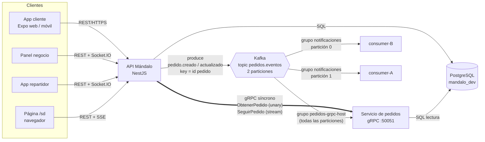

# Sistemas Distribuidos — gRPC + Kafka sobre Mándalo

Mándalo es una app de domicilios en producción (cliente, negocio y repartidor;
NestJS + PostgreSQL + Expo). En la rama `sistemas-distribuidos` del backend se le
agregó un servicio gRPC de pedidos y un flujo de eventos con Kafka, corriendo
contra la base de **dev** (producción no se toca).

| Pieza | Dónde |
|---|---|
| Contrato gRPC | `proto/pedidos.proto` |
| Stubs generados con protoc | `src/distributed/generated/pedidos.ts` (`pnpm proto:gen`) |
| Servidor gRPC | `src/distributed/grpc/grpc.main.ts`, `pedidos-grpc.controller.ts` |
| Cliente gRPC (consola) | `src/distributed/grpc/grpc-client.main.ts` |
| Cliente gRPC (API → página `/sd`) | `src/distributed/demo/demo.controller.ts` |
| Producer Kafka real (pedidos de la app) | `src/distributed/kafka/order-events.publisher.ts` (enganchado en `InvoiceGateway.emitToOrg`) |
| Producer Kafka simulado | `src/distributed/kafka/simulate-producer.main.ts` |
| Consumer Kafka (grupo `notificaciones`) | `src/distributed/kafka/consumer.main.ts` |
| Infraestructura | `sistemas-distribuidos/docker-compose.yml` |
| Evidencias (logs) | `sistemas-distribuidos/evidencias/` |

---

## Parte 1 — Servicio gRPC

**Contrato** (`proto/pedidos.proto`), servicio `mandalo.pedidos.PedidosService`:

| Método | Tipo | Qué hace |
|---|---|---|
| `ObtenerPedido(ObtenerPedidoRequest) → PedidoResumen` | **unary** | Lee el pedido en Postgres (estado, negocio, municipio, totales, pago). `NOT_FOUND` si no existe. |
| `SeguirPedido(SeguirPedidoRequest) → stream EventoPedido` | **server-streaming** | Manda primero un *snapshot* desde la DB y luego empuja cada cambio de estado que llega por Kafka. `pedido_id = 0` sigue todos. |

**Generar stubs:** `pnpm proto:gen` ejecuta `protoc` con el plugin `ts-proto`
(`nestJs=true`). Genera las interfaces `PedidosServiceClient` /
`PedidosServiceController` y el decorador `PedidosServiceControllerMethods`.
En Windows: `PROTOC=C:/ruta/protoc.exe pnpm proto:gen`.

**Probar local:**

```bash
pnpm build
KAFKA_BROKERS=localhost:9092 node --env-file=.env.development dist/src/distributed/grpc/grpc.main   # servidor :50051
node dist/src/distributed/grpc/grpc-client.main 149   # unary + stream del pedido 149
node dist/src/distributed/grpc/grpc-client.main 0     # stream de todos los pedidos
```

Evidencia: `evidencias/05-servidor-grpc.log`, `06-cliente-grpc-stream.log`, `07-cliente-grpc-unary.log`.

## Parte 2 — Mensajería con Kafka

1. **Clúster de 1 broker** (KRaft, sin ZooKeeper): servicio `kafka` del compose (`apache/kafka:3.9.1`).
2. **Topic con 2 particiones**: `kafka-init` crea `pedidos.eventos --partitions 2` (`evidencias/01-crear-topic.log`).
3. **Producer**:
   - *Real*: cada vez que un pedido se crea o cambia de estado en la app, el API publica `pedido.creado` / `pedido.actualizado` / `pedido.eliminado`.
   - *Simulado*: `pnpm kafka:simular` genera pedidos que recorren `PEND → ACEP → PREP → RUTA → ENTR` (`evidencias/02-producer-simulado.log`).
   - **Clave del mensaje = id del pedido** → todos los eventos de un pedido van a la misma partición y se consumen **en orden**.
4. **Consumer**: `consumer.main.ts` en el grupo `notificaciones` arma la notificación ("Nuevo pedido #… en …") y lleva contadores por estado.
5. **Dos consumers en el mismo grupo** (`consumer-a`, `consumer-b`):
   - Al arrancar: A → partición `[1]`, B → partición `[0]` (`evidencias/03-consumer-A.log`, `04-consumer-B.log`).
   - Al apagar B, el grupo se **rebalancea** y A queda con `[0, 1]` (`evidencias/03-consumer-A.log`, `09-producer-tras-rebalanceo.log`).

Además, el servicio gRPC consume el mismo topic con **un grupo propio por
réplica** (`pedidos-grpc-<host>`): ahí el objetivo es *broadcast* (cada réplica
necesita todos los eventos), no repartir trabajo. Es el contraste con el grupo
`notificaciones`.

## Parte 3 — Mini-arquitectura



### Justificación

**gRPC para la comunicación síncrona interna (API → servicio de pedidos).**
Cuando el API necesita el estado de un pedido, necesita la respuesta en ese
momento para contestar al usuario: es petición/respuesta, y gRPC encaja ahí.
Primero, el contrato `.proto` es tipado y versionable: cliente y servidor
generan su código del mismo archivo, así que un campo mal escrito falla al
compilar y no en producción. Segundo, viaja en Protocol Buffers sobre HTTP/2,
que es binario, compacto y multiplexado. Para tráfico interno entre servicios
es más eficiente que JSON sobre HTTP/1.1, y como nadie lo consume desde fuera,
no se pierde nada por no ser legible. Tercero, HTTP/2 trae **streaming
nativo**: `SeguirPedido` mantiene un canal abierto por donde el servidor
empuja los cambios del pedido sin que el cliente haga *polling*, que es
justamente el seguimiento en vivo que pide un domicilio. Los errores tienen
códigos estándar (`NOT_FOUND`, `UNAVAILABLE`) en vez de convenciones propias.

**Kafka para los eventos asíncronos entre servicios.** Que un pedido se cree o
cambie de estado es un *hecho* que le interesa a varios (notificaciones,
seguimiento en vivo, y mañana analítica o liquidaciones). El API no debería
esperar a ninguno ni saber cuántos son. Con Kafka el API publica y sigue: si
un consumer está caído, el pedido igual se crea, y el consumer retoma desde su
último *offset* cuando vuelve, porque el log es durable. Las **particiones**
dan paralelismo: dos instancias del mismo grupo se reparten el trabajo, y si
una cae, la otra toma sus particiones solas (rebalanceo, visto en las
pruebas). Usar **el id del pedido como clave** garantiza que los eventos de un
mismo pedido nunca se procesen en desorden (no se puede "entregar" antes de
"aceptar"), aunque haya varios consumers. Y los **consumer groups** permiten
los dos patrones con el mismo topic: *reparto de trabajo* (grupo
`notificaciones`) y *difusión* (un grupo por réplica del servicio gRPC).

**Por qué no al revés.** Kafka para consultar un pedido obligaría a correlacionar
peticiones y respuestas a mano y añadiría latencia sin beneficio. gRPC para
difundir eventos acoplaría el API a cada servicio interesado: tendría que
conocerlos, llamarlos uno por uno y manejar sus caídas. Cada tecnología queda
donde su modelo (petición/respuesta vs. log de eventos) coincide con la
interacción.

---

## Correr todo

**Con Docker** (local o Dokploy):

```bash
cd sistemas-distribuidos
cp .env.example .env    # DB de dev + variables del API
docker network create dokploy-network
docker compose -f docker-compose.yml -f docker-compose.local.yml --profile local up --build
```

- API + página de demo: http://localhost:3000/sd (perfil `local`; antes: `docker network create dokploy-network`)
- Kafka UI: http://localhost:8080
- Logs en vivo: `docker compose logs -f consumer-a consumer-b pedidos-grpc api`

**Sin Docker** (lo que se usó para las evidencias, Kafka 3.9.1 nativo en Windows):
el `kafka-server-start.bat` de Windows usa `wmic` (ya no existe en Windows 11), así que el broker se arrancó con
`kafka-run-class.bat kafka.Kafka config\kraft\local.properties` y los servicios con `node dist/...`.
